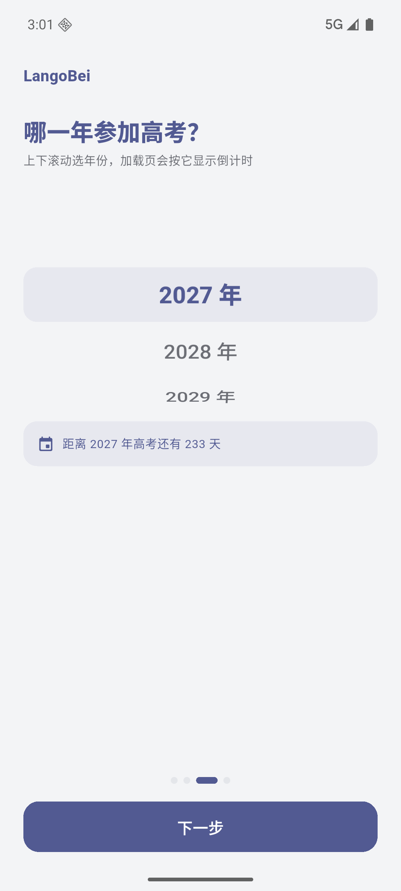

# LangoBei

面向高考英语的背单词 App：3540 词离线词库、三种掌握状态、错题回流、进度量化。用 Flutter 写的，目前只出 Android 包。

- **不用联网**：词库打包在安装包里，飞机上、地铁里都能背
- **不用登录**：没有账号、没有云同步、没有广告，打开就能开始
- **数据是你自己的**：学习记录只存在本机，随时可以导出成 JSON 带走
- 外观可调：深色模式 + 主题色四选一，白底区域始终是纯白

MIT 协议开源，自用、二改、商用都可以，保留版权声明即可。

## 下载安装

到 [Releases](https://github.com/Ligret2007/LanGouBei/releases/latest) 下载 `LangoBei-v1.0.0.apk`，在手机上点开安装即可（首次安装需要在系统里允许「安装未知应用」）。

- 支持 Android 7.0 及以上（`minSdk 24`），安装包约 50 MB
- 不需要任何权限，也不联网；卸载重装不会上传任何数据

想自己编译，见下面的[怎么跑起来](#怎么跑起来)。

## 界面预览

| 引导 · 词库 | 引导 · 高考年份 | 知新 · 翻开释义 |
| :---: | :---: | :---: |
|  |  |  |

| 量化 · 7 日成果 | 更多 · 词库 / 数据 | 外观 · 主题色四选一 |
| :---: | :---: | :---: |
|  |  |  |

其余截图（引导介绍 / 就绪、错题插入、反思空状态、深色模式、改高考年份）都在 [docs/screenshots](docs/screenshots) 里。

## 它能做什么

### 四个板块

| 板块 | 做什么 |
| --- | --- |
| **知新** | 每天在这儿背词。点卡片翻面看释义，然后选「不认识 / 模糊 / 认识」；选「不认识」的词自动进错题本。顶部显示今日已选次数、错题本数量、已掌握数量 |
| **反思** | 只复习错题本里的词，选项简化成「认识 / 不认识」——认识就移出，不认识就留着。错题本空了会有空状态提示 |
| **量化** | 把进度摊开：距高考天数、连续学习天数、今日正确率、已掌握数量与百分比进度条、错题本数量，以及近 7 天的选择次数柱状图 |
| **更多** | 换词库、改高考年份、切深色模式与主题色、导出学习数据、看版本信息、清空进度重新走引导 |

### 掌握度是怎么判的

每个词只有三种状态：

| 状态 | 条件 |
| --- | --- |
| **已掌握** | 最近三次评价全是「认识」 |
| **错题本** | 在知新里选了「不认识」 |
| **未掌握** | 其他情况 |

另外两条规则不太显眼，但会实际影响判定：

- **3 秒规则**：卡片停留超过 3 秒，不管你点的是「认识」还是「不认识」，掌握度都按「模糊」记录。界面当时不会提示你，选项次数也照实统计——被悄悄调整的只有掌握度。目的是别让「想了很久才想起来」和「一眼就认识」混为一谈。
- **错题会回来找你**：每答完 5 个新词，就实时抽一张错题插进来。
- 每个词还没被评价过时，会多出一个「确定认识」——点了直接进已掌握。

### 词库

内置两个难度，随时可换：

| 词库 | 词数 | 说明 |
| --- | --- | --- |
| **高考：我是菜鸟** | 3014 | 覆盖高考高频，基础到进阶 |
| **高考：我是大神** | 3540 | 在菜鸟的基础上增加低频词 |

- 词库是**本项目自编**的，每个词带音标、词性、释义和难度分级：`easy`（绿）/ `normal`（黄）/ `hard`（橙）/ `extra`（红），单词卡正反面都带这个标签
- **换库不丢进度**：进度按单词 id 记录，换完「知新」按新词库重新排队
- 四级词汇、雅思 6.5 留了入口，目前灰着标「敬请期待」
- 想换成自己的词表：词库就是一个 JSON 文件（`assets/words_gaokao.json`），照着字段格式替换，或用 `tool/build_vocab.py` 从纯文本词表（每行「单词 音标 分级 释义」）生成

### 高考年份与倒计时

引导第三页用滚动选择器选高考年份（2027–2040），之后在「更多 → 当前设置」里随时能点开改。选完，App 里到处都会显示距离高考还有多少天。

### 外观

- **深色模式**：跟随系统 / 浅色 / 深色
- **主题色**：默认蓝 / 深绿 / 紫色，第四格先留空
- 主题色只染标题、大标题、按钮、进度条、选中态这类醒目位置；卡片与页面底色一律中性色，**白色区域保持纯白**

### 导出学习数据

「更多 → 数据」有三个入口，互相兜底：

| 按钮 | 做什么 |
| --- | --- |
| **导出为文件** | 生成 `langobei-年月日-时分秒.json` 写进系统「下载」目录（Android 10+ 不需要存储权限），提示条上带「复制路径」 |
| **复制 JSON** | 整份 JSON 进剪贴板（只有学过的词才占地方） |
| **分享文本** | 走系统分享面板发出去，微信、邮件都行 |

导出内容包括设置、给人看的汇总（已掌握 / 正确率 / 连续天数等）和原始进度数据，字段说明见 [docs/技术细节.md](docs/技术细节.md)。导出不会改动任何学习状态。

## 怎么跑起来

需要 Flutter 3.47 或更高（项目按 Flutter 3.47 / Dart 3.13 写的），依赖只有 `shared_preferences`。

```bash
git clone https://github.com/Ligret2007/LanGouBei.git
cd LanGouBei
flutter pub get
flutter run                    # 连上手机或模拟器，改代码即时热重载
flutter build apk --release    # 产物：build/app/outputs/flutter-apk/app-release.apk
flutter analyze
flutter test                   # 62 个测试
```

## 代码结构

```
lib/
  main.dart                 入口 + 路由（引导 / 加载页 / 主界面）
  app_state.dart            词库、设置、学习档案、队列、掌握度算法、持久化
  export_service.dart       导出数据组装
  theme.dart                Material 3 主题与分级配色
  models/word.dart          Word / WordProgress / DayStat / Settings，词库名单与年份区间
  widgets/                  翻转卡、词库选项卡、年份滚轮
  screens/                  引导、加载页、四个板块
android/.../MainActivity.kt 原生通道：写「下载」目录、拉起分享面板
```

持久化只用 `shared_preferences` 存一份 JSON，连续操作时 600ms 防抖写盘——没有数据库，也没引状态管理框架，`ChangeNotifier` 加一层 `ListenableBuilder` 就够了。

## 数据与隐私

- 词库在安装包里，学习记录在手机本地，**App 不发起任何网络请求**
- 没有账号体系，所以换手机得自己导出再导入（导入功能还没做，导出 JSON 的结构是照着「将来能直接喂回去」设计的）
- 清空进度只删学习记录，外观偏好会保留

## 已知限制

- 目前只有 Android 版（没做过 iOS 适配）
- release 关闭了 R8 压缩：AGP 9 的默认压缩会裁掉插件反射调用的方法，装上就崩，等插件适配后再打开
- 词库只有单词 / 音标 / 词性 / 释义，没有例句和真人发音
- 四级、雅思词库还是占位；导出有了，导入还没做

## 开源协议

[MIT](LICENSE) © 2026 Ligret —— 随便用、随便改、可以商用，只要保留版权声明。

---

作者是个高三生，这个 App 最早是写给自己背单词用的。如果它对你也有用，欢迎提 issue 说哪里不好用。
