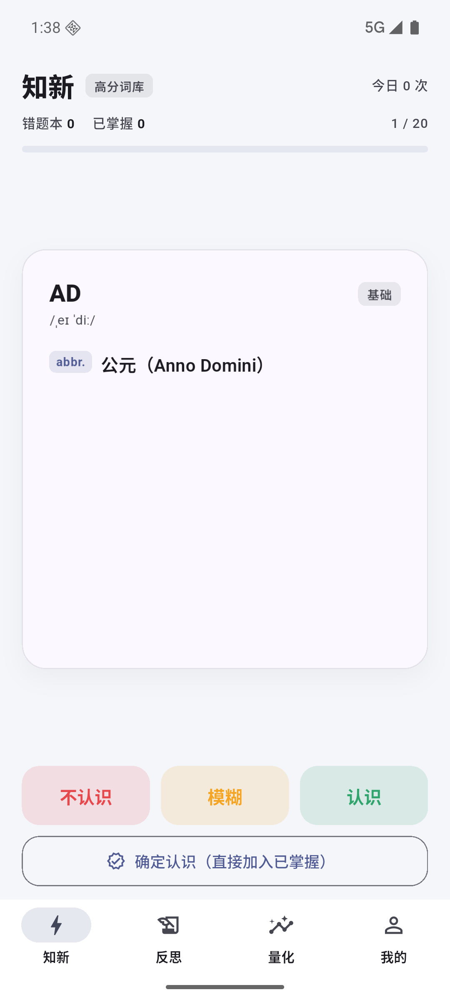
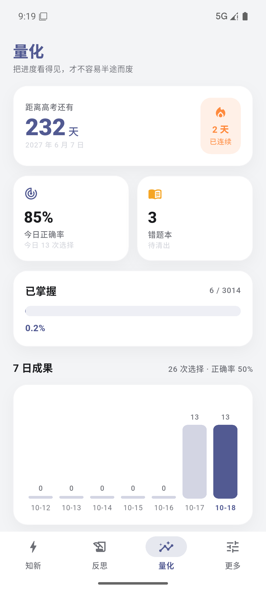
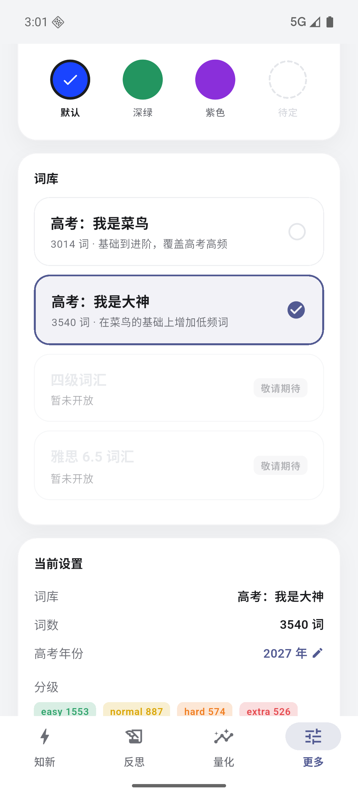
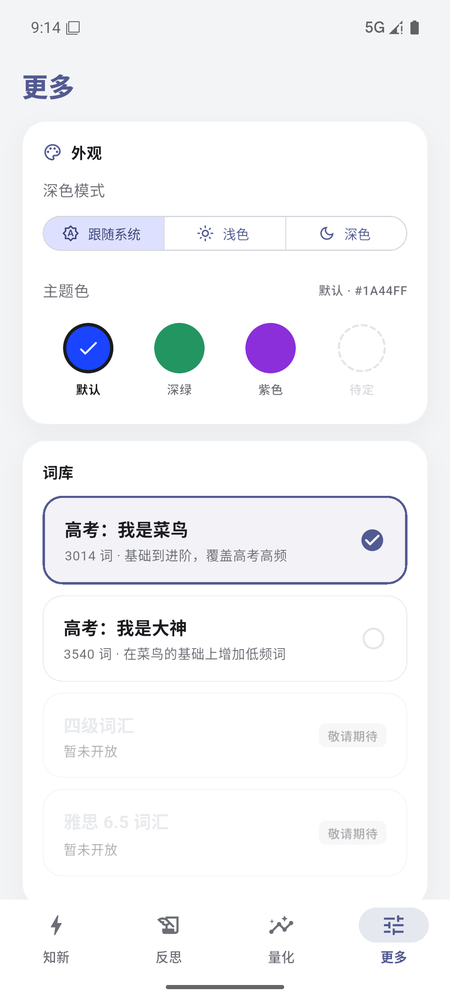
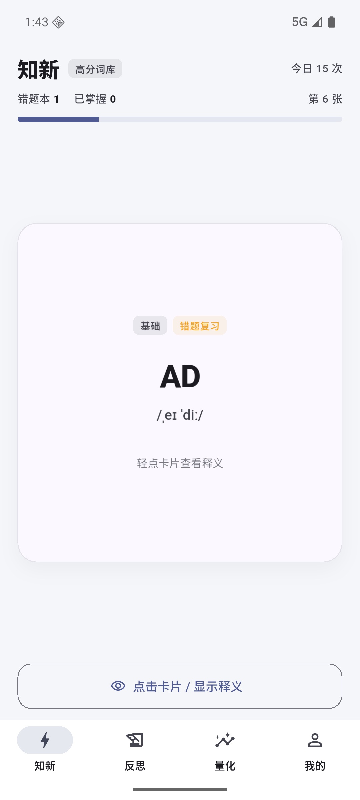
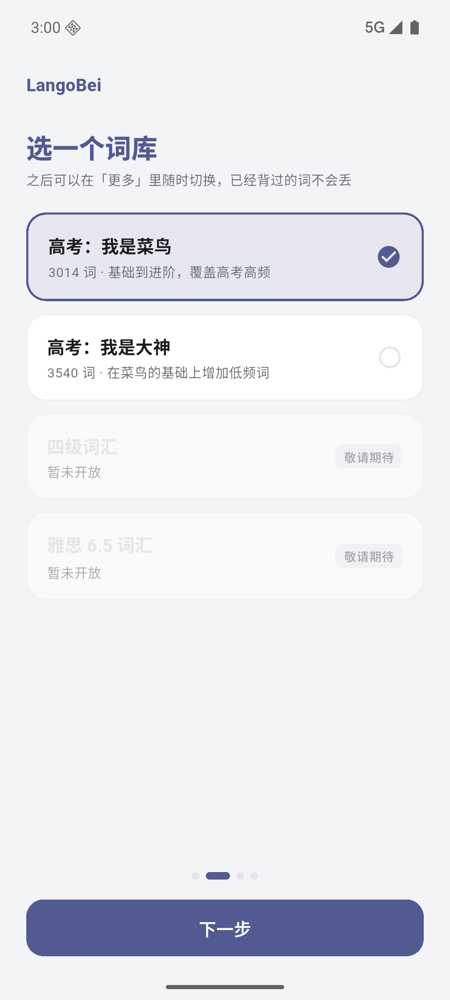

# LangoBei

面向高考英语的背单词 App：3540 词离线词库、三种掌握状态、错题回流、进度量化。Flutter 写的，目前只出 Android 包。

- **不用联网、不用登录**：词库打包在安装包里，学习记录只存在本机，随时能导出成 JSON 带走
- **不要权限、没有广告**：打开就能背，卸载重装不会上传任何数据
- 深色模式 + 主题色四选一，白色区域始终是纯白

MIT 协议开源，自用、二改、商用都可以，保留版权声明即可。

## 下载安装

到 [Releases](https://github.com/Ligret2007/LanGouBei/releases/latest) 下载 `LangoBei-v1.1.0.apk`，在手机上点开安装即可（首次安装需要在系统里允许「安装未知应用」）。支持 Android 7.0 及以上（`minSdk 24`），安装包约 50 MB。

想自己编译，见下面的[怎么跑起来](#怎么跑起来)。

## 界面预览

| 知新 · 翻开释义 | 量化 · 7 日成果 | 更多 · 设置与数据 |
| :---: | :---: | :---: |
|  |  |  |

| 外观 · 主题色四选一 | 知新 · 错题插入 | 引导 · 选词库 |
| :---: | :---: | :---: |
|  |  |  |

其余截图（引导介绍 / 就绪、高考年份、反思空状态、深色模式）都在 [docs/screenshots](docs/screenshots) 里。

## 它能做什么

| 板块 | 做什么 |
| --- | --- |
| **知新** | 每天在这儿背词：点卡片翻面看释义，然后选「不认识 / 模糊 / 认识」；选「不认识」的自动进错题本。顶部显示今日已选次数、错题本数量、已掌握数量 |
| **反思** | 只复习错题本里的词，选项简化成「认识 / 不认识」——认识就移出，不认识就留着 |
| **量化** | 把进度摊开：距高考天数、连续学习天数、今日正确率、已掌握进度条，以及近 7 天的选择次数柱状图 |
| **更多** | 换词库、改高考年份、切深浅色与主题色、导出学习数据、看版本信息、清空进度重走引导 |

### 出词顺序

「知新」不按字母表出词，也不是纯随机：

- **伪随机**：每次进「知新」或点「再来一组」都重新洗一遍，同一轮里顺序固定——不会看着看着下一张跳走，你也猜不到下一张是什么
- **难度按占比摊平**：四个难度交错出现，比例跟着它们在词库里的占比走（菜鸟库约 `easy` 52% / `normal` 29% / `hard` 19%），任意一段都贴着这个比例，不会连着来一串同难度
- 每个难度内部**没见过的词优先**，见过的词按「最久没复习」排在本级后面

### 掌握度怎么判

每个词只有三种状态：**已掌握**（最近三次评价全是「认识」）、**错题本**（在知新里选了「不认识」）、**未掌握**（其余情况）。

另有两条不太显眼但会实际影响判定的规则：

- **3 秒规则**：卡片停留超过 3 秒，掌握度一律按「模糊」记录——选项次数照实统计，界面当时不提示。目的是别让「想了很久才想起来」和「一眼就认识」混为一谈
- **错题会回来找你**：每答完 5 个新词，实时抽一张错题插进来；每个词第一次出现时还多一个「确定认识」，点了直接进已掌握

算法细节见 [docs/技术细节.md](docs/技术细节.md)。

### 词库

| 词库 | 词数 | 说明 |
| --- | --- | --- |
| **高考：我是菜鸟** | 3014 | 覆盖高考高频，基础到进阶 |
| **高考：我是大神** | 3540 | 在菜鸟的基础上增加低频词 |

- 词库是**本项目自编**的，每个词带音标、词性、释义和难度分级（`easy` 绿 / `normal` 黄 / `hard` 橙 / `extra` 红），卡片正反面都带这个标签
- **换库不丢进度**：进度按单词 id 记录，换完「知新」按新词库重新排队；四级、雅思留了入口，目前灰着标「敬请期待」
- **自己的词库能导进来**：「更多 → 词库 → 导入词库」，选 `.json` 文件或直接粘贴 JSON 都行；导入后自动切过去，右侧「⋯」里能导出成文件、复制 JSON、删除。格式见 [docs/词库格式.md](docs/词库格式.md)
- 想换成自己的词表：词库就是一个 JSON 文件，照着字段格式替换，或用 `tool/build_vocab.py` 从纯文本词表生成（内置的两个库靠 `assets/banks/index.json` 装配，加随包词库不用改代码）

高考年份在引导第三页用滚动选择器选（2027–2040），之后在「更多 → 当前设置」里随时能改，App 里到处都会显示距离高考还有多少天。

### 导出学习数据

「更多 → 数据」有三个互相兜底的入口：**导出为文件**（生成 `langobei-年月日-时分秒.json` 写进系统「下载」目录，Android 10+ 不需要存储权限）、**复制 JSON**、**分享文本**（走系统分享面板）。导出内容是设置、给人看的汇总和原始进度数据；导出不会改动任何学习状态。

## 怎么跑起来

需要 Flutter 3.47 或更高（项目按 Flutter 3.47 / Dart 3.13 写的），依赖只有 `shared_preferences`。

```bash
git clone https://github.com/Ligret2007/LanGouBei.git
cd LanGouBei
flutter pub get
flutter run                    # 连上手机或模拟器，改代码即时热重载
flutter build apk --release    # 产物：build/app/outputs/flutter-apk/app-release.apk
flutter analyze
flutter test                   # 80 个测试
```

## 代码结构

```
lib/
  main.dart                 入口 + 路由（引导 / 加载页 / 主界面）
  app_state.dart            当前词库、设置、学习档案、掌握度算法、持久化
  bank/                     词库接口：JSON 格式解析、词库来源、注册表、文件存储
  motion.dart               动效时长与曲线，全站统一从这里取
  crisp.dart                字号与布局吸附到整设备像素
  word_queue.dart           知新队列排法：伪随机 + 按难度占比均匀交错
  export_service.dart       导出数据组装
  version.dart              版本号（和 pubspec 一起改）
  theme.dart                Material 3 主题与分级配色
  models/word.dart          Word / WordProgress / DayStat / Settings，词库名单与年份区间
  widgets/                  翻转卡、词库选项卡、年份滚轮
  screens/                  引导、加载页、四个板块
android/.../MainActivity.kt 原生通道：写「下载」目录、分享面板、词库文件读写与文件选择
```

持久化只用 `shared_preferences` 存一份 JSON（连续操作时 600ms 防抖写盘）——没有数据库，也没引状态管理框架，`ChangeNotifier` 加一层 `ListenableBuilder` 就够了。

## 数据与隐私

- 词库在安装包里，学习记录在手机本地，**App 不发起任何网络请求**；没有账号体系，所以换手机得自己导出（学习数据的导入还没做，导出 JSON 是照着「将来能直接喂回去」设计的；词库本身已经能导入导出）
- 清空进度只删学习记录，外观偏好会保留

## 已知限制

- 只有 Android 版（没做过 iOS 适配），词库只有单词 / 音标 / 词性 / 释义，没有例句和真人发音
- release 关闭了 R8 压缩：AGP 9 的默认压缩会裁掉插件反射调用的方法，装上就崩，等插件适配后再打开
- 四级、雅思词库还是占位；学习数据的「导入」还没做（词库的导入导出已经能用了）
- 只做竖屏：手机锁竖屏；平板或折叠屏横放时，内容会收成一条竖屏宽度的中栏，不做横屏布局

## 开源协议

[MIT](LICENSE) © 2026 Ligret —— 随便用、随便改、可以商用，只要保留版权声明。

---

作者是个高三生，这个 App 最早是写给自己背单词用的。如果它对你也有用，欢迎提 issue 说哪里不好用。
